<div align="center">
  
</div>

<br/>

<div align="center">
  
  
  
  
</div>

<br/>

<div align="center">
  
</div>

<br/>

### `// 0x01 :: OPERATOR_TRADECRAFT`

```text
┌─────────────────────────────────────────────┬──────────────────────────────────────────────────────────┐
│ DOMAIN                                      │ OPERATIONAL FOCUS                                        │
├─────────────────────────────────────────────┼──────────────────────────────────────────────────────────┤
│ [01] API & GraphQL Exploitation             │ Schema Reconstruction · WAF Evasion · BOLA · Auth Flaws  │
│ [02] Real-Time & Async Protocol Abuse       │ WebSocket Hijacking · Race Conditions · State Desync     │
│ [03] Autonomous Recon & AppSec Auditing     │ Entropy/Secret Extraction · AI-Code PR Risk Triaging     │
│ [04] AI Agents & LLM Infrastructure         │ Live Web Intelligence · Real-Time Verification Plugins   │
│ [05] Full-Stack & Systems Engineering       │ TypeScript · FastAPI · High-Concurrency Go & Rust Tools  │
│ [06] Quantitative Systems (Private R&D)     │ Statistical Modeling · Systematic Risk & Market Engines  │
└─────────────────────────────────────────────┴──────────────────────────────────────────────────────────┘
```

---

### `// 0x02 :: WEAPONIZED_STACK`

<div align="center">
  
  
  
  
  
  
  
  
  
  
  
</div>

---

### `// 0x03 :: DECLASSIFIED_MODULES`

| Module | Classification | Telemetry |
| :--- | :--- | :--- |
| **[`secretscope`](https://github.com/flysand-ZR-7/secretscope)** | `PUBLIC // RECON` | Fast, local-first bug bounty reconnaissance and high-entropy secret-detection framework |
| **[`risk-radar`](https://github.com/flysand-ZR-7/risk-radar)** | `PUBLIC // APPSEC` | Automated PR risk triager & security scanner for AI-generated code changes |
| **[`live-info-plugin`](https://github.com/flysand-ZR-7/live-info-plugin)** | `PUBLIC // AI_AGENT` | Production-grade live internet, news, web reading & fact-verification plugin for LLMs |
| **[`parqur`](https://github.com/flysand-ZR-7/parqur)** | `PUBLIC // PLATFORM` | Full-stack smart parking and urban mobility management platform (TypeScript) |
| **[`time-weather-utilities`](https://github.com/flysand-ZR-7/time-weather-utilities)** | `PUBLIC // TOOLING` | Real-time global weather, timezone conversion, solar & astronomical utilities plugin |
| **`GQLHunter v2.0`** | `CLASSIFIED // BLACKBOX` | High-concurrency Go GraphQL Endpoint Finder, 8-Stage WAF Bypass & 20-Check Scanner |
| **`curlprobe v2.0`** | `CLASSIFIED // BLACKBOX` | Multi-threaded HTTP status, redirect chain (`301`/`302`) & perimeter fingerprinting engine |
| **`QuantCore`** | `CLASSIFIED // PRIVATE` | Private quantitative research, statistical modeling & systematic risk-analytics engine |

---

<div align="center">
  <sub>
    <code>0x46 0x4C 0x59 0x53 0x41 0x4E 0x44 :: [NO_LOGS_RETAINED] :: CONNECTION_TERMINATED</code>
  </sub>
</div>
